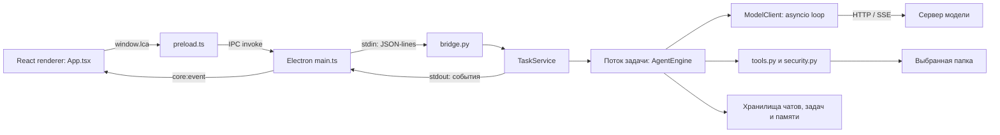
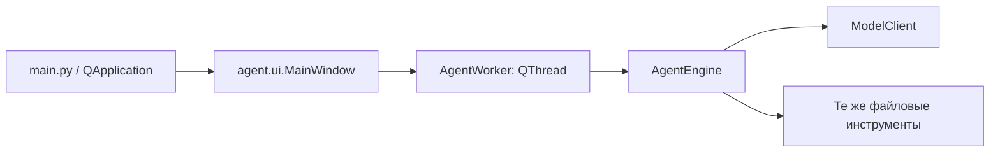

# 3. Архитектура и границы ответственности

## Общая схема

Стрелки не означают общий доступ к памяти: между Electron и Python данные сериализуются. Между `TaskService` и `AgentEngine` передаются обычные Python-объекты и callback-вызовы в одном процессе.

## Кто чем владеет

| Компонент | Ответственность | Чем не должен заниматься |
| --- | --- | --- |
| `App` | Состояние UI, ввод пользователя, показ текста и diff | Прямой доступ к файловой системе и произвольному IPC |
| Preload | Фиксированный `window.lca` и подписка на события | Общий `invoke(method, args)` для любой команды |
| Electron main | Окно, выбор папки, запуск Python, номера запросов | Самостоятельное применение предложенного моделью кода |
| `bridge.py` | Разбор команд, ответы, файловый предпросмотр, stdout-протокол | Генерация ответа модели в главном цикле чтения stdin |
| `TaskService` | Один активный запуск, чат, конфигурация, approvals, события | Собственная альтернативная реализация инструментов |
| `AgentEngine` | Диалог с моделью, цикл инструментов, завершение, память | Знание React-компонентов или Qt-виджетов |
| `ModelClient` | Отменяемый HTTP, доставка чанков, закрытие клиента | Разрешение записи файлов |
| `tools` и `security` | Проверка путей, diff, чтение/поиск/запись | Доверие утверждению модели «пользователь согласился» |
| Stores | Чат, контрольная точка, память, настройки | Выполнение инструкций, обнаруженных в JSON |

## Модель выполнения Python

В основном потоке работает `bridge.main`: читает stdin, вызывает `handle`, печатает ответ. `TaskService.start` запускает отдельный daemon-поток `agent-task`, чтобы цикл модели не блокировал команду `cancel_task`.

`ModelClient` создаёт ещё один daemon-поток `model-http` с отдельным asyncio loop. Корутина получает HTTP/SSE, очередь на 64 чанка связывает её с синхронным потребителем. Синхронный код проверяет `Event` и ожидает элементы короткими интервалами. Ограниченная очередь создаёт обратное давление: producer не должен бесконечно накапливать чанки при медленном потребителе.

Небольшой `threading.Timer` в `TaskService` допечатывает накопленный текст примерно через 40 мс, даже если сервер сделал паузу. Он защищён тем же `RLock`, что и финальная отправка сообщения, и проверяет `run_id`. Это предотвращает перемешивание финального ответа и старого текстового буфера.

`list_models` — отдельное исключение из синхронного dispatch: `bridge.main` запускает `model-discovery`, затем продолжает читать stdin. Worker получает копию настроек, создаёт короткоживущий asyncio loop и возвращает результат с исходным request ID. Одновременно разрешён один такой worker. `cancel_task` и EOF отменяют также discovery; основной поток не ждёт сетевой timeout.

`bridge.emit` отдельно использует `output_lock`: два Python-потока не должны одновременно записать половинки разных JSON-строк в stdout.

## Жизненный цикл процесса

Python запускается лениво при первом `callBackend`. Main сохраняет ожидающие запросы в `pending`. Обычный ответ находится по `id`; событие с полем `event` сразу передаётся renderer. При `error`, `exit` или ошибке stdin pending-запросы завершаются ошибкой, UI получает `backend_stopped`.

Следующая команда может снова запустить Python, но состояние выбранного проекта в новом процессе отсутствует. UI очищает свой выбранный проект и предлагает выбрать его заново. Чаты и задачи на диске позволяют восстановить работу. Это перезапуск процесса, а не автоматическое бесшовное восстановление всех переменных.

При закрытии приложения main завершает stdin и убивает дочерний процесс. При жёстком завершении нет гарантии сохранения последнего токена. При открытии чата embedded checkpoint переводит running в paused, сохранённый draft восстанавливается, а неопределённая файловая запись требует проверки. Индекс и отдельный task-файл восстанавливаются из канонической записи чата.

## Сохранённый путь Qt

`AgentWorker` содержит экземпляр движка и преобразует его `EventHook` в Qt `Signal`. Компоненты Qt получают сообщения своим механизмом сигналов. Signal `text_delta` в адаптере уже есть, но текущий `MainWindow` не подключает к нему отрисовку; потоковый текст в новой форме отображает Electron.

## Почему понадобилось разделение

Исходный `AgentWorker` объединял цикл задачи с наследованием от `QThread`. Electron не использует Qt event loop. Выделение `AgentEngine` позволяет запускать один алгоритм через два адаптера и проверять Core без Qt. При этом это постепенная миграция: некоторые вспомогательные классы ещё не встроены в активный сценарий, а React-представление пока находится в одном большом компоненте.

Помимо 40-мс таймера UI, `TaskService` использует отдельный draft-таймер до одной секунды для сохранения последнего текста во время паузы сервера. Оба таймера проверяют run/turn, закрываются при сохранении полного сообщения и не могут дописать старый draft в следующий запуск. Ошибка сохранения draft вызывает сообщение об ошибке и отмену текущей задачи.
