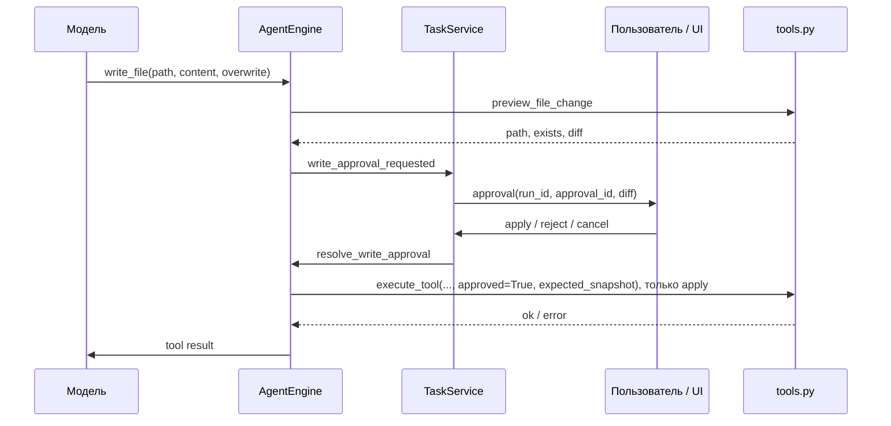

# 5. Один запрос от кнопки до результата

Разберите сценарий в пустой учебной папке: «Создай файл `hello.txt` с текстом `Привет`». Важен не конкретный ответ модели, а порядок проверяемых действий.

## 1. Подготовка интерфейса

`chooseProject` вызывает `window.lca.chooseProject`. Electron показывает системный диалог и передаёт путь в `set_project`. Python разрешает путь через `resolve(strict=True)`, проверяет каталог, сбрасывает выбранный чат в сервисе и возвращает корень. `App` обновляет `root`, `project`, список файлов и чатов.

Настройки модели отправляются `configureModel`. Сервис проверяет URL, сохраняет только не-секретные поля и держит ключ в `config` процесса. Загрузка списка моделей выполняет GET `<base_url>/models`; сама модель ещё не получает задачу.

## 2. Нажатие «Отправить»

`sendPrompt` обрезает внешние пробелы, проверяет наличие проекта и модели и выставляет `active.current` до первого `await`. Это защищает от повторных быстрых нажатий. Если чат ещё не создан, сервис генерирует его ID и сохраняет пустую запись.

Renderer добавляет пользовательское сообщение на экран, вызывает `startTask` и получает `run_id`. События могут прийти раньше этого ответа, поэтому подписка уже активна, а `chat_id` известен заранее.

## 3. Быстрая команда и длительная задача

Main отправляет строку вида:

```json
{"id": 7, "method": "start_task", "params": {"prompt": "Создай hello.txt", "resume": false}}
```

`bridge.handle` проверяет выбранный проект и вызывает `TaskService.start`. Сервис запрещает параллельный запуск, проверяет длину запроса, выбирает историю и память, создаёт `AgentEngine`, подписывает обработчики и запускает поток. Ответ `ok: true` означает принятие задачи, а не её завершение.

## 4. Сообщения модели

`AgentEngine.run` формирует system prompt, дополняет его выбранными краткими описаниями навыков и памятью проекта, добавляет историю и новый запрос. Перед модельным вызовом рабочий контекст ограничивается.

В запросе есть `model`, `messages`, `tools`, `tool_choice: "auto"`, `temperature`, `max_tokens` и `stream: true`. `ModelClient` исполняет async-корутину. SSE-чанки несут либо текст, либо фрагменты имени и JSON-аргументов инструмента. Фрагменты tool call собираются по `index`; исполнение начинается после окончания соответствующего модельного ответа.

## 5. Что видит пользователь до завершения

Текстовый `delta.content` вызывает `text_delta.emit(turn, text)`. Сервис отправляет событие `text_delta` с `message_id = run_id:turn`, объединяя мелкие фрагменты. React либо создаёт assistant-сообщение с этим ID, либо дописывает его текст.

После получения полного текста событие `chat` заменяет содержимое того же сообщения и снимает признак streaming. Это отличается от добавления второго одинакового сообщения. Индекс цикла модели нужен потому, что одна задача может иметь несколько промежуточных ответов.

## 6. Инструмент чтения и инструмент записи

Если модель вызвала `read_file`, движок передаёт аргументы в `execute_tool`, результат сериализуется как сообщение `role: "tool"` с тем же `tool_call_id`. На следующем цикле модель может опереться на прочитанный текст.

Для `write_file` путь другой:



`overwrite: true` показывает намерение заменить существующий файл, но не заменяет согласие пользователя. Неверный путь или отсутствующий родительский каталог отклоняется ещё на этапе preview. Пока диалог открыт, файла ещё нет.

## 7. Три исхода диалога

`apply` разрешает текущую операцию. `reject` возвращает модели `USER_DENIED`; агент может продолжить обсуждение или предложить другой вариант. `cancel` возвращает `USER_CANCELLED` и завершает текущую задачу с приостановкой. Повторное применение старого `approval_id` отклоняется.

После одобрения `write_file` снова проверяет путь и совпадение snapshot с исходными байтами и предложенным текстом. Конфликт возвращает `FILE_CHANGED` и требует нового diff. Существующий файл заменяется атомарно; новый создаётся без перезаписи появившегося target. Событие `change` со статусом `applied` означает успешный результат инструмента, а не просто закрытие диалога.

## 8. Завершение и память

Если модель не вернула инструменты, движок считает ответ кандидатом на финал. Для запросов действия возможны ещё до двух проверок завершённости через модель. Отдельный необязательный вызов обновляет структурированную память по кратким данным и метаданным инструментов.

Затем сохраняются контрольная точка, сообщения, итоговый текст. `task_end` отправляется после завершения `run` и закрытия клиента. UI разрешает следующую отправку и обновляет список чатов.

## 9. Остановка в середине генерации

Команда `cancel_task` выставляет `Event`, отменяет активные async-future и освобождает ожидание approval. Сетевой контекст закрывает HTTP-поток. Движок сохраняет текст, который уже показывал, без незаконченных tool-call аргументов; задача становится `paused`.

Это останавливает ожидание и соединение клиента. Продолжит ли сервер вычисление после отключения клиента, зависит от самого сервера; наш код не управляет его GPU-процессом напрямую.

## 10. Продолжение

Кнопка продолжения передаёт `resume: true`. Сервис берёт исходный prompt из checkpoint, движок повышает `resume_state.attempt` и использует сохранённую историю. Он заново обращается к модели и инструментам. Это не восстановление точного токена или сетевой сессии; проверка текущих файлов по-прежнему важна.

## Аварийное завершение и открытие

До запуска thread начальный prompt и checkpoint сохраняются вместе. Перед ожиданием approval архив уже содержит assistant tool call, а checkpoint — pending_write. Перед фактической записью журнал становится applying. После инструмента сначала сохраняется tool result в transcript, затем снимается отметка pending_write. Это позволяет после сбоя различать известный результат и неопределённую запись; пользователь получает paused и ясное предупреждение вместо автоматического повторения старого согласия.

Во время текста первый фрагмент и периодические draft сохраняются отдельно от незавершённого сообщения. При открытии чата последний сохранённый фрагмент добавляется к истории один раз. Отдельный tasks-файл и индекс считаются восстанавливаемыми копиями для Electron. Старые чаты без дополнительных полей продолжают открываться через совместимый путь.
