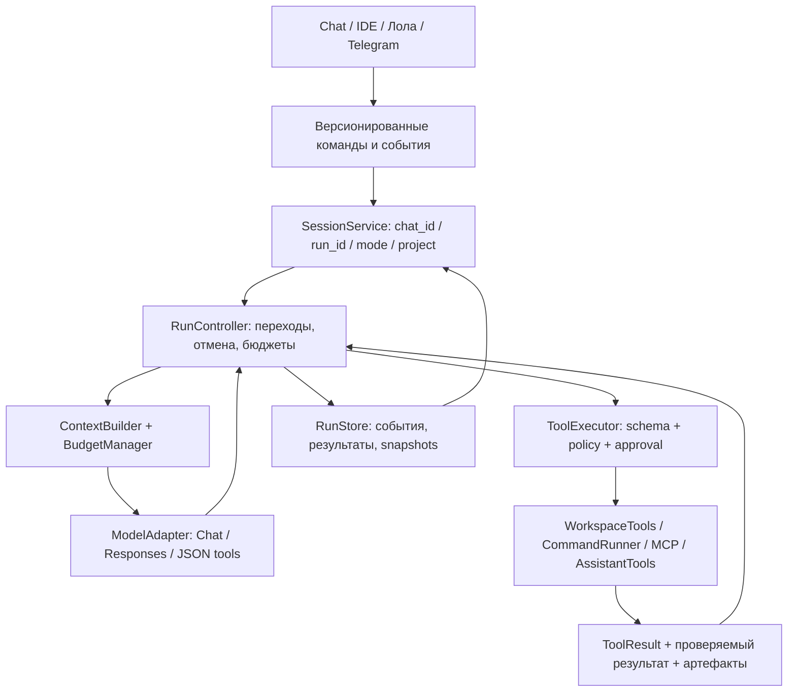

# Аудит ядра Neutral и план развития

Дата: 25 октября 2026. Проверенная база: `9572082e8f0c4ce625e515fdb7e5c0ac466a8b09`,
ветка `codex/electron-agent-bridge`, Neutral 7.0.0. До аудита рабочая копия была чистой.
Первый сеанс охватил аудит и документацию. После команды пользователя реализован
[первый этап надёжности](41-core-reliability-stage-one.md): A2/A3/A6/A7/A8/A9,
runtime и промежуточное отображение проверок A1. 26 октября выполнен
[этап 2: исполнение и восстановление](42-core-execution-and-recovery.md):
RunState/ToolExecutor, durable call journal, частичные пачки A4 и проверяемые
ограничения завершения A1. Таблица проблем ниже описывает исходную базу.
26 октября выполнен также [этап 3: контекст и экономия](43-context-budget-and-economy.md):
окончательный wire budget A5 с резервом, отложенные schemas, reader результатов,
usage и условное обновление памяти. Офлайн-оценка явно консервативна, не является
точным токенизатором произвольной модели.
Рабочий набор IDE реализован в [этапе 4](44-ide-tools-and-progress-panel.md):
общий отменяемый поиск, glob/read_range, подтверждаемые patch/mkdir/rename/delete,
scoped AGENTS.md и закрываемая панель подробностей. Acceptance criteria и файловый
откат остаются этапу 6, транзакционное хранение — следующему этапу 5.

## Вывод

Сохраняем Electron → Python Core → модель и один основной агентный цикл.
Основа пригодна для развития: есть потоковые ответы, отмена HTTP, проверки путей,
diff с контролем ревизии, каноническая история, восстановление задач, настоящие MCP,
Responses и JSON tool calling. Полная перепись или возврат четырёх моделей по ролям
сейчас увеличат стоимость и риск.

Основной недостаток — разрыв между состоянием задачи, доказательствами выполнения
и контекстом модели. Существующий код иногда считает работу завершённой по тексту
модели, теряет полезные результаты при сжатии и не сохраняет для модели частично
исполненную пачку вызовов. Это важнее нового дизайна или дополнительных инструментов.

## Объём и достоверность проверки

- Прочитаны активные пути engine/runtime, TaskService/bridge, контекст, история,
  файловые tools, команды, MCP/расширения, адаптеры моделей, настройки и Electron IPC.
- Поиск ссылок показал, какие старые абстракции реально используются.
- 67 выбранных существующих тестов прошли: 23 unit/сервисных и 44 проверки
  команд, Responses, TaskService, HTTP streaming и JSON-протокола.
- Дополнительный [скрипт воспроизведения](../tools/audit_core_20261025.py) использует
  временные папки, синтетические ответы и фиктивные ключи. Он показывает наблюдения,
  а не объявляет обнаруженные ошибки корректным поведением.
- Первые запуски в Windows sandbox столкнулись с ограничением временной папки;
  незавершённый тестовый процесс остановлен. Приведённые результаты получены
  повторным изолированным запуском с обычным доступом к временным файлам.
- GPU, оплачиваемые API и пользовательские проекты для проверок не использовались.
  Полная GUI/installer-регрессия повторно не запускалась: приложение не менялось.
- Claude Code и Cursor сравниваются по официальной публичной документации,
  проверенной в этот день. Их закрытые внутренние реализации не исследовались.
  Это не сравнительный тест качества моделей или скорости продуктов.

## Подтверждённые проблемы

P1 — исправить до расширения автономного исполнения. P2 — важная надёжность
и совместимость, но ограниченный сценарий возникновения. P0 не установлен.

| ID | Приоритет | Проблема и доказательство | Что изменить |
| --- | --- | --- | --- |
| A1 | P1 | Команда проверки вернула `ok=false`, `exit_code=7`, затем модель написала итог: задача стала `completed`, `test_results=[]`, `StageVerifier.verify` вызван 0 раз. [Завершение](../agent/engine.py#L365), [verifier](../agent/verifier.py#L3). | Отделить конец ответа от выполнения задачи. Проверки должны создавать структурированные свидетельства; допустимы статусы «готово», «не проверено», «проверка не прошла». Решение модели не должно переопределять провал обязательной проверки. |
| A2 | P1 | `finish_reason=length` с непустым текстом даёт `completed`. Причина окончания читается, но используется только для диагностики пустого ответа. [Код](../agent/engine.py#L305). | Ввести явные причины окончания: stop, length, refusal, cancelled, transport_error. Оборванный ответ сохранять как частичный; продолжать ограниченно либо предлагать продолжение. Не выполнять незавершённый tool call. |
| A3 | P1 | При сжатии 12 643 символов результата команды остаются только `ok`, длина и hash: исчезают `exit_code` и `output`. Из 11 455 символов MCP `content[]` тоже исчезает весь текст. [Сжатие](../agent/smart_context.py#L35). | Нормализовать результаты всех tools перед сжатием. Сохранять статус, код выхода, существенные строки, ссылки на полный результат и возможность дочитать его. Hash без адресуемого оригинала недостаточен. |
| A4 | P1 | В пачке из двух calls первый имеет сохранённый успешный результат, второй прерван. `_complete_units` исключает всю пачку из контекста, включая успех первого. Для внешнего действия без результата recovery ставит `interrupted`, а не неопределённый исход. [Пары](../agent/conversation.py#L89), [recovery](../agent/task_activity.py#L63). | Восстанавливать каждый call отдельно. Сохранённые результаты оставлять; не начатым выдавать `not_executed`, начатым без ответа — `outcome_unknown`. Внешние изменения не повторять автоматически. Для них нужны журнал до/после вызова и сверка состояния. |
| A5 | P1 | Лимит контекста не включает определения tools и последующее преобразование JSON-протокола. При лимите 12 000 символов сообщения до адаптера занимали 78, после добавления восьми допустимых схем — 170 268. [Формирование запроса](../agent/engine.py#L272), [JSON-адаптер](../agent/json_tools.py#L8), [snapshot](../core/python/extension_service.py#L171). | Считать весь итоговый запрос после адаптации, резервировать ответ и служебные данные. Учитывать окно конкретной модели и токены, а не только символы. Загружать схемы MCP по необходимости. |
| A6 | P2 | `write_file` с `path=null` обрывает весь запуск с TypeError. Встроенные tools не проходят общую JSON Schema валидацию, а preview записи находится вне общего перехвата ошибок обработчика. [Код](../agent/engine.py#L448). | Единый ToolExecutor: schema validation → policy → approval → execute → normalize result. Ошибка аргументов должна стать результатом tool для исправления моделью, а не падением всей задачи. |
| A7 | P2 | Electron ждёт MCP discovery 10 с; Python допускает по умолчанию 30, максимум 120 с. Запоздавший ответ больше не имеет pending-запроса. Повторное нажатие создаёт ещё один worker. [IPC](../apps/desktop/electron/main.ts#L120), [worker](../core/python/bridge.py#L258), [timeout MCP](../agent/mcp_client.py#L18). | Общий контракт deadline/cancel/progress; одна discovery-операция на сервер. UI должен получать финальный результат той же операции. Проверить сценарий ответа через 15 с при timeout 30 с. Это вывод по коду, не проведённый 15-секундный GUI-прогон. |
| A8 | P2 | Два допустимых server ID с общими первыми 25 символами и одинаковым tool name дают одинаковый alias. В snapshot две схемы, но один маршрут: последний сервер перекрывает первый. Воспроизведено без реальных серверов. [Alias](../core/python/extension_service.py#L163). | Hash должен включать полный server ID, transport identity и tool name; проверять уникальность до публикации схем. Сохранённым схемам нужна миграция/повторное discovery. |
| A9 | P1 | Backend Лолы сохраняет прежние model/STT ключи, если URL изменён, а ключ не передан. UI очищает model key при смене URL, но STT поле этого не делает. На фиктивных настройках оба ключа сохранились. [Backend](../core/python/task_service.py#L121), [UI](../apps/desktop/src/CompanionSettings.tsx#L46). | Привязать credentials к типу сервиса и endpoint. Менять endpoint — сбрасывать ключ в backend и UI. Защитить также случай, когда старый ключ явно пришёл из устаревшей формы. Факт передачи реального ключа постороннему серверу не проверялся и не утверждается. |

Дополнительное несоответствие лимитов: настройки разрешают runtime от одной минуты,
но [движок](../agent/engine.py#L251) применяет минимум пять. Общий срок проверяется
между циклами модели; длинная пачка tools и ожидание approval могут его превысить.
Следует отдельно определить время исполнения и время ожидания человека, показывать
их в UI и передавать оставшийся бюджет каждому исполнителю.

Воспроизведение наблюдений:

```powershell
.\.venv-test\Scripts\python.exe tools/audit_core_20261025.py
```

Для A4 подтверждена потеря результата в проекции и неоднозначность recovery;
повтор внешнего действия является возможным следствием, а не наблюдавшимся инцидентом.
Для A5 измерен размер запроса, а не фактический OOM: причиной прежнего отключения
мониторов этот аудит такой запрос не объявляет.

## Архитектурные ограничения

| Область | Что есть сейчас | Почему это ограничивает развитие |
| --- | --- | --- |
| Агентный цикл | `AgentEngine.run` совмещает prompts, stream, dispatch, approvals, checkpoints, memory и финализацию. `TaskService` дополнительно владеет глобальными chat/run/model/approval. | Трудно проверить переходы по отдельности; изменение одного сценария затрагивает IDE, Chat, Лолу и Telegram. Размер файла сам по себе не ошибка, проблема — смешанные обязанности. |
| Частично подключённые абстракции | `AgentRuntime` создаёт planner/verifier/старый MCPRegistry, но engine не вызывает verifier/complete_stage. `ModelGateway` не входит в рабочий путь. `PlanStage.max_turns` не исполняется. | Названия создают впечатление более строгой архитектуры, чем реально работает. Нужны одна активная реализация и явный статус legacy-кода. |
| Хранилище | Полные chat JSON и индекс атомарно перезаписываются; task сохраняется отдельно и внутри chat. `read_chat_catalog` читает все чаты для списка. [Код](../agent/chat_store.py#L72). | Это обеспечивает полезное восстановление, но стоимость записи растёт с историей. Нет транзакции вокруг результатов tools, чата и состояния запуска. Деградация под нагрузкой пока не измерялась. |
| Поиск агента | `search_text` заранее собирает список файлов, не принимает cancellation/deadline, ищет literal text и пропускает файлы >120 КБ. GUI уже имеет более ограниченный по ресурсам `ProjectSearchService`. | Агент может искать дольше UI, пропускать важные файлы и поздно реагировать на Stop. Нужен один поисковый сервис для обоих потребителей. |
| Редактирование | Четыре файловых инструмента; `write_file` требует полного текста и существующей родительской папки. Нет инструментов patch/mkdir/move/delete. | Большие изменения дороги по токенам; новая структура проекта требует ручной подготовки или разрешённой команды. Это недостающие возможности, а не скрытый обход доступа. |
| Доступ к данным | Корень и junction/symlink проверяются, команды требуют согласия, но `.gitignore` и политика исключения секретов отсутствуют у tools. Синтетический `.env` читался и находился поиском. | Нужен отдельный `.neutralignore` и правила чувствительных файлов. `.gitignore` сам по себе не является политикой безопасности. Окно подтверждения команды не заменяет изоляцию ОС. |
| MCP | Новый процесс/сессия на каждый вызов, весь набор схем включённых серверов в каждом запросе. | Повторная инициализация увеличивает задержку; серверные сессии между вызовами не сохраняются. Развивать после A5/A7/A8: session manager, lazy schemas, лимиты и корректный shutdown. |
| Память и лимиты | После успешной IDE-задачи отдельный LLM-запрос памяти; некоторые запросы запускают ещё проверку завершения. Учёт usage/cost отсутствует. | Лишняя задержка и расход. Нужен видимый бюджет задачи, отключение/отложенное обновление памяти, provenance и актуальность записей. Короткие вопросы не должны обязательно запускать ещё одну модельную операцию. |
| UI и протокол | Явный preload и isolation уже есть, но main использует `any`, bridge — строки методов и словари, App координирует много локальных состояний. | Контракты могут расходиться; нужны схемы событий и запросов, session reducer и разделение сервисов без изменения визуального стиля. |
| Лола | Отдельный профиль модели и голосовой контур, общий реестр расширений и один активный TaskService. | Один запуск экономит VRAM и допустим сейчас. Но политику «код только основной модели» лучше выразить режимными capability-профилями, в том числе для MCP, а не только prompt и эвристикой делегирования. |

## Сравнение с Claude Code и Cursor

| Принцип | Публично описанный ориентир | Что взять для Neutral |
| --- | --- | --- |
| Цикл работы | Claude Code описывает сбор контекста → действие → проверку с возможностью прерывания. [Источник](https://code.claude.com/docs/en/how-claude-code-works). | Оставить один цикл, добавить проверяемые переходы и итог по свидетельствам. Документация конкурента не доказывает, что его проверки всегда успешны. |
| Контекст | Claude Code показывает состав контекста, сжимает историю и откладывает загрузку схем MCP до использования. [Источник](https://code.claude.com/docs/en/how-claude-code-works). | BudgetManager для полного payload, просмотр расхода, lazy schemas и доступ к полным сохранённым результатам. |
| Поиск | Актуальная страница Cursor описывает локальный Instant Grep и отдельный Explore-контекст. [Источник](https://cursor.com/docs/agent/tools/search). | Сначала быстрый ограниченный lexical search, glob и чтение диапазонов. Векторная база не является обязательным первым шагом. |
| План | Cursor позволяет исследовать проект, получить редактируемый план и отдельно начать выполнение. [Источник](https://cursor.com/docs/agent/plan-mode). | Read-only Plan Mode и критерии готовности в плане; фиксированные надписи «анализ/исследование» не заменяют содержательные шаги. |
| Инструкции проекта | Claude Code описывает CLAUDE.md/AGENTS.md и память; Cursor — scoped rules и вложенные AGENTS.md. [Claude](https://code.claude.com/docs/en/memory), [Cursor](https://cursor.com/docs/rules). | Поддержать AGENTS.md и пользовательские правила с областью действия, источником и бюджетом. Инструкции не расширяют права инструментов. |
| Откат | Claude Code хранит файловые checkpoint; у Cursor есть откат изменений Agent. [Claude](https://code.claude.com/docs/en/checkpointing), [Cursor](https://docs.cursor.com/en/agent/chat/checkpoints). | Разделить checkpoint диалога и snapshot файлов. Сделать откат набора правок с проверкой последующих ручных изменений. Не обещать откат любых внешних/terminal-действий. |
| Права | Claude Code описывает изоляцию shell на macOS/Linux/WSL2; на native Windows команды выполняются без неё. Cursor прямо называет правила запуска guardrails, а не жёсткой границей. [Claude](https://code.claude.com/docs/en/sandboxing), [Cursor](https://cursor.com/docs/agent/security). | Единый PolicyService для tools/файлов/сети. Native Windows честно показывать как режим подтверждений; изоляцию через WSL2/контейнер сделать отдельной возможностью. MCP не считать автоматически изолированным. |
| Делегирование | Claude Code subagents имеют отдельный контекст/права и расходуют общий лимит запросов. [Источник](https://code.claude.com/docs/en/sub-agents). | После стабилизации можно добавить необязательного read-only исследователя с бюджетом. Обязательная цепочка четырёх моделей не нужна; на этом ПК параллельность по умолчанию остаётся 1. |

## Предлагаемые границы модулей

Сначала выделить интерфейсы и адаптеры вокруг работающих функций, затем переносить
реализации по одному сценарию. Пути ниже — целевая схема, не уже созданные модули.



| Компонент | Контракт и ответственность |
| --- | --- |
| SessionService | Выбор чата/проекта, независимое состояние каждого режима, жизненный цикл run. Очередь вычислений отдельна от истории разговоров. |
| RunController | `running → waiting_approval → executing → verifying → completed/needs_attention/paused/failed`; единственный владелец переходов. Не знает React и формат OpenAI. |
| ToolSpec / ToolResult | Schema, scope, класс побочного эффекта, timeout, cancellable, replay policy; результат содержит status, exit_code, краткую сводку, artifact_id, сведения о проверке. |
| PolicyService / ApprovalService | Разрешения, выбранные папки, исключения, origin endpoint, привязка согласия к run/call/аргументам/ревизии. Используются одинаково для всех источников команд. |
| ContextBuilder / ModelAdapter | Каноническая история отдельно от запроса модели; бюджет после преобразования; capabilities, stop reason, usage и ошибки представлены явно. |
| RunStore / ArtifactStore | Устойчивый журнал событий, транзакционные результаты, адресуемый полный stdout/tool output; UI строится из проекции. Один источник истины вместо конкурирующих копий. |

Хранилище разумно перевести на локальный SQLite с WAL и транзакциями после введения
контрактов. Экспорт/резервные копии сохранять в JSON. Миграция должна копировать старые
данные, иметь версию, сверять число чатов/сообщений и не удалять исходники до проверки.
Файловые snapshots и большие артефакты лучше хранить отдельно с ссылками из базы.

## План внедрения по порядку

Каждый этап — отдельное проверяемое изменение. Размеры S/M/L означают относительный
объём, а не обещание уложить весь план в один остаток лимита.

| Этап | Объём | Изменения | Критерий приёмки и UI |
| --- | --- | --- | --- |
| 1. Исправить текущие сбои — выполнено | M | A2/A3/A6/A7/A8/A9, согласовать runtime; для A1 временно показывать «проверка не подтверждена», если нет свидетельств. Перенести воспроизведения в regression tests. | Оборванный текст не зелёный; stdout/MCP сохраняют содержание; неверные args возвращаются модели; разные MCP не смешиваются; URL не наследует ключ. Продуктовый дизайн прежний. |
| 2. Надёжное исполнение — выполнено | L | RunState, ToolExecutor/ToolPolicy, границы Approval и журнал call lifecycle; A1/A4. `test_results` восстанавливается из реальных command receipts. [Подробности](42-core-execution-and-recovery.md). | 54 новых unit-регрессии, пять реальных process-exit границ, перезапуск bridge и Electron recovery в IDE/Лоле: известный успех не теряется, неизвестный эффект не повторяется; UI отличает отказ, сбой и неподтверждённый результат. |
| 3. Контекст и экономия — выполнено | M | A5: консервативный бюджет окончательного payload с резервом; lazy MCP schemas, ограниченные диапазоны сохранённых результатов. Usage и причины сжатия в UI; память по необходимости. [Подробности](43-context-budget-and-economy.md). | 16 новых регрессий: 4K/8K/32K, русский текст, native/JSON/Responses, большие schemas; payload проходит настроенный предел либо отклоняется до HTTP. GUI показывает breakdown, reported usage и пресеты окна. |
| 4. Рабочий набор IDE — выполнено | M | Общий cancellable поиск, glob/read_range, patch_file/create_directory/rename_file/delete_file с preview, scoped AGENTS.md. [Подробности](44-ide-tools-and-progress-panel.md). | 21 новая unit-регрессия и HTTP workflow: вложенная структура через разрешённые tools, небольшая правка без полного файла в ответе модели, отмена поиска, сохранность ручных правок. Electron проверяет закрытие подробностей без остановки задачи. |
| 5. Хранилище и восстановление — выполнено | L | SQLite/WAL для чатов/checkpoint/receipts/проектов, копирующая миграция v1, SHA-256 artifacts и индекс истории. [Подробности](45-transactional-storage-and-migration.md). | 17 новых контрактов миграции/аварий/backup; список без transcript scan. На 2000 чатах: p50 списка 480 → 10 мс, поиска 4 мс. В настройках проверка и ZIP-копия. |
| 6. Проверки и откат IDE — выполнено | M | Пользовательские критерии и set_task_plan, readonly policy, purpose/exit code, post-edit/checks_only, snapshots и подтверждаемый conflict-aware откат. [Подробности](46-ide-acceptance-and-rollback.md). | 18 новых unit-контрактов и 2 HTTP workflow; настоящий process exit при rollback, manual conflicts и stale evidence. Electron проверяет реальную доступность кнопок, diff/confirm и readonly. Дополнительных прав у проверок нет. |
| 7. Сервисы и интерфейс — выполнено | M | Уменьшить TaskService/App через session store и адаптеры; типизированный IPC; общий deadline/cancel; MCP session manager и режимные capability profiles. | Chat/IDE/Лола/Telegram проходят одинаковые сценарии stop/resume/approve. Голосовой контур остаётся отзывчивым. Одна тяжёлая inference-задача одновременно по умолчанию. |
| 8. Необязательные возможности — реализовано | L | Readonly исследователь, stdio LSP diagnostics, managed Git worktrees и Linux-container adapter. [Подробности](48-optional-ide-capabilities.md). | Отдельные opt-in и budgets; 14 новых unit-контрактов, HTTP cancel и Electron workflow. Реальный Docker engine на этом ПК отсутствует: execution/cleanup проверены fixture, нужна проверка на установленной среде. |

Этапы 3 и 4 можно разрабатывать независимо после согласования контрактов этапа 2,
но применять и проверять последовательно. Полный перенос хранилища не должен
задерживать маленькие исправления этапа 1.

## Проверки для каждого изменения

1. Unit-контракт и сценарий ошибки: не только успешный вызов, но malformed args,
   cancellation, endpoint change, finish_reason и сохранение evidence.
2. Реальный локальный HTTP/SSE и MCP fixture: обрыв после части ответа,
   batch из нескольких tools, сервер медленнее UI timeout, повторный запрос.
3. Crash/restart вокруг каждого побочного эффекта; журнал должен различать
   `prepared`, `started`, `succeeded`, `failed`, `outcome_unknown`.
4. Electron smoke для изменённого пользовательского пути. Не пересобирать
   установщик на каждый маленький backend patch; собирать на завершённый этап.
5. Небольшой набор задач качества: новая структура проекта, исправление одного
   дефекта, ответ без записи, длинный контекст, непрошедший тест, stop/resume.
   Измерять долю выполненных критериев, ложных «готово», повторных изменений,
   tokens/requests, p50/p95 задержки и расход памяти. Реальные локальные модели
   запускать по одной с безопасными настройками и фиксированной версией.

Уже выполненные команды выбранной регрессии:

```powershell
.\.venv-test\Scripts\python.exe -m unittest tests.test_runtime_architecture tests.test_smart_context tests.test_approval_flow tests.test_neutral_extensions tests.test_neutral_conversations -q
.\.venv-test\Scripts\python.exe -m unittest tests.test_project_command tests.test_responses_adapter tests.migration.test_task_service tests.migration.test_streaming tests.migration.test_json_protocol -q
```

Этап 7 завершён: [сессии, протокол и MCP](47-session-services-and-mcp.md).
Этап 8 реализован последовательно после проверок этапа 7: [дополнительные возможности](48-optional-ide-capabilities.md).
Новые функции остаются выключенными по умолчанию; ограничение реальной Docker-проверки указано явно.
