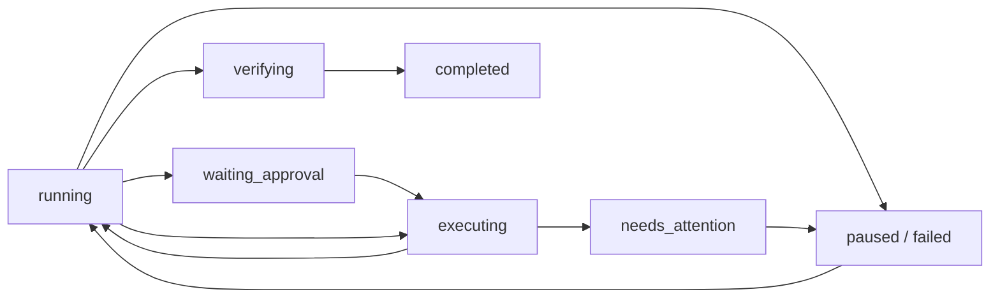

# Этап 2: исполнение и восстановление инструментов

26 октября 2026 года. Продолжение [аудита ядра](40-core-audit-and-roadmap.md)
и [первого этапа](41-core-reliability-stage-one.md). Эта глава описывает рабочие
исходники Electron/Core, классы, порядок записи данных и проверенные границы.
Ранее собранный установщик этих изменений пока не содержит.

## Что меняется для пользователя

При обычной работе инструменты продолжают появляться в карточке хода задачи.
Теперь карточка различает ожидание разрешения, выполнение, проверку, ошибку,
остановку и результат, который неизвестен после сбоя.

Если приложение завершилось во время записи файла или внешнего действия:

1. Откройте прежний чат. Известные результаты восстановятся из журнала.
2. Если результат неизвестен, проверьте сам файл, приложение или внешний сервис.
3. Выберите «Действие уже выполнено» либо «Действие не выполнялось», затем
   «Подтвердить результат». До второго нажатия данные не отправляются.
4. После проверки всех пунктов станет доступно «Продолжить задачу».
   Проверка результата сама по себе не запускает ни инструмент, ни модель.

В Chat и IDE карточка находится в ходе задачи, у Лолы — прямо в области
разговора. Голосовая активация и STT сохраняют распознанный текст, но не
отправляют новый запрос, пока прерванное действие требует проверки.

Пока остаются неизвестные действия, Core запрещает также новый запрос в этом
чате и создание его копии. Создать отдельный независимый разговор можно.
Старые подтверждения записи и команд после перезапуска не действуют.

Если приложение закрылось **в ожидании согласия**, действие ещё не началось.
Оно помечается «Не выполнено», проверка внешнего результата не нужна.
Новая попытка исполнения требует обычного нового согласия.

Если журнал повреждён в полной строке либо не соответствует истории, Core
сохраняет исходные данные, показывает ошибку восстановления и запрещает запуск.
Нельзя исправлять такую ситуацию удалением отдельных квитанций наугад.

## Ответственность модулей

| Файл | Основные объявления | Для чего нужен |
| --- | --- | --- |
| [run_state.py](../agent/run_state.py) | `RunState`, `InvalidRunStateTransition` | Проверяемые переходы жизненного цикла; независимы от содержательных этапов плана |
| [tool_executor.py](../agent/tool_executor.py) | `ToolPolicy`, `ToolExecutor` | Единая проверка разрешённого имени/аргументов, согласия, границы эффекта и сохранение квитанции |
| [call_journal.py](../agent/call_journal.py) | `CallJournal` | Полные calls/results в append-only JSONL с `flush` и `fsync` |
| [tool_recovery.py](../agent/tool_recovery.py) | `task_journal`, `recover_task`, `_import_legacy` | Сверка журнала с каноническим диалогом, восстановление evidence и UI metadata |
| [engine.py](../agent/engine.py) | `AgentEngine` | Модельный цикл, контекст, лимиты и финальная проверка; делегирует исполнение `ToolExecutor` |
| [task_service.py](../core/python/task_service.py) | `TaskService` | Выбранный чат, idle gate, scoped RPC, подтверждения и сохранение проекции диалога |
| [verifier.py](../agent/verifier.py) | `StageVerifier` | Реальные результаты команд, неизвестные действия и причины остановки перед завершением |
| [TaskProgress.tsx](../apps/desktop/src/TaskProgress.tsx) | `TaskProgress`, `taskStatusLabel` | Различимые состояния и двухшаговая ручная проверка неизвестного результата |

`ToolPolicy` получает копию определений инструментов на момент запуска.
`validate` проверяет имя, JSON и объявленную schema до вызова handler.
`effectful` использует фиксированный список встроенных readers. Неизвестный tool
и любой MCP считаются потенциально меняющими состояние. Серверные annotations
MCP не дают разрешений и не доказывают отсутствие побочных эффектов.

Граница согласия остаётся связана с работающими адаптерами: diff и файловый
snapshot для `write_file`, `run_id`/одноразовый approval ID для команд и MCP.
`before_external_approval` и `after_external_approval` связывают их с журналом.
Полная изоляция команд средствами ОС этим изменением не добавляется.

## Жизненный цикл запуска



Диаграмма показывает основные пути, а полная матрица находится в `RunState`.
`completed` терминален для своей эпохи. Остановленную задачу сначала возвращают
в `running`; нельзя перейти из ожидания нерешённого согласия прямо в completed.
`stage/stages` описывают план и не подменяются фазой исполнения.

Для совместимости старые потребители получают `status=running` во всех активных
фазах, `completed` при завершении и `paused` при paused/failed/needs_attention.
Новый Electron использует более точный `run_state` и отдельные подписи.

## Долговечные границы одного вызова

Порядок принципиален:

1. Модель возвращает полную пачку calls. `prepare_batch` сохраняет имена,
   исходные строки аргументов, IDs и якорь assistant-сообщения.
2. `ToolExecutor` валидирует call. Ошибка схемы получает настоящую квитанцию
   ошибки без вызова handler.
3. Подтверждаемый tool сохраняет `awaiting_approval` и ждёт решения. Отказ
   сохраняется как `USER_DENIED`/`USER_CANCELLED`, `started` не появляется.
4. После разрешения сохраняется `started`. Только после возврата этой записи
   выполняются реальная запись файла, программа или внешний handler.
5. `record_result` сохраняет полный результат. Только затем обновляются
   task/activity, история чата, UI и контекст следующего модельного запроса.

Для write после согласия дополнительно сверяется ранее показанный snapshot.
Если файл успел изменить пользователь, остаётся `FILE_CHANGED`, чужая правка
не затирается. Запись через специальную ветку executor сохраняет прежнюю защиту
корня, diff и `overwrite`; custom dispatcher не обходит её.

Для подтверждаемых MCP/команд `TaskService` передаёт executor явный список
`approval_tools`. Их `started` записывается только после согласия через hook.
У MCP с явно выключенным подтверждением `started` предшествует handler сразу.

## Формат и восстановление

Журнал находится в `%LOCALAPPDATA%\LocalCodingAgent\tasks\journals`.
Имя вычисляется из `chat_id` и `journal_id`; данные проекта рядом не создаются.
`journal_id` обозначает эпоху задачи и сохраняется при её продолжении.
Новое задание получает новый ID. Старые журналы сохраняются до удаления чата.

События версии 1 содержат `chat_id`, `journal_id`, `message_index`, тип события
и call identity. `message_index` адресует **полную каноническую историю без
временного system prompt**. Идентичность вызова — индекс пачки плюс `call_id`:
некоторые локальные модели повторяют один ID в разных ответах.

Фазы: `prepared`, `awaiting_approval`, `started`. После них может следовать
`result` или ручное `resolution`. Строка ограничена 4 МБ; не конечные JSON-числа
и слишком большие результаты не записываются. Ошибка хранения останавливает
работу; она не даёт права начать эффект без durable границы.

`recover` сначала проверяет все якоря на независимой копии истории. Расхождение
имени, аргументов, ID, пересечение пачек либо конфликт настоящих receipts
останавливают восстановление. Нельзя сопоставлять только одинаковые call IDs.

Для корректной частичной пачки результаты восстанавливаются так:

| Состояние перед сбоем | Результат восстановления | Продолжение |
| --- | --- | --- |
| Квитанция уже сохранена | Исходный результат | Успех/ошибка не теряются даже при устаревшем task/chat checkpoint |
| Только prepared/awaiting_approval | `NOT_EXECUTED` | Новый вызов допускается по обычным правилам |
| Начат встроенный reader, квитанции нет | `TOOL_INTERRUPTED` | Можно запросить повторное чтение |
| Начат эффект, квитанции нет | `OUTCOME_UNKNOWN` | Требуется проверка пользователя |
| Получен `OUTCOME_UNKNOWN` от транспорта | `OUTCOME_UNKNOWN` | Такой же запрет автоматического повтора |

Потерянный хвост assistant+tools можно дописать только в точной следующей
позиции. Внутри частичной пачки сохранённые успехи остаются на месте, все
отсутствующие ответы получают явную парную запись. Контекст больше не выбрасывает
всю пачку из-за одного отсутствующего результата. Orphan и malformed exchanges
по-прежнему исключаются из проекции для модели.

Оборванная последняя JSONL-строка игнорируется и отрезается перед следующей
записью. Полное корректное событие без завершающего перевода строки сохраняется.
Полностью записанная повреждённая строка не пропускается молча.
Экземпляры одного журнала разделяют in-process lock. Это ещё не транзакционная
БД и не гарантия одновременной работы нескольких независимых Core с одним профилем.

`recover_task` восстанавливает `test_results`, `modified_files`, последние 100
activity и `recovery_items`. Повторное открытие не создаёт новые activity IDs.
Старые завершённые блоки не переписываются; незавершённые legacy-блоки
консервативно импортируются с учётом прежнего pending_write/activity.

## Ручное решение и IPC

Путь: `TaskProgress → App.resolveToolRecovery → preload.resolveToolRecovery →
task:resolve-recovery → bridge.resolve_tool_recovery → TaskService`.

Запрос содержит выбранные `chat_id`, `journal_id`, `message_index`, `call_id`
и `resolution=completed|not_executed`. Core требует idle, проверяет выбранное
пространство и неизвестный call. Старые карточки, чужой чат, bool вместо индекса,
повторное решение и попытка изменить известный результат отклоняются.

Журнал сохраняет `USER_CONFIRMED_EFFECT` либо `USER_CONFIRMED_NOT_EXECUTED`.
Это наблюдение человека. Исходные stdout, exit code или ответ внешнего сервиса
не восстанавливаются догадкой. UI показывает «Подтверждено вами», модель получает
пометки `user_confirmed`/`result_unavailable` и соответствующую инструкцию.
Согласие на новый tool-вызов по-прежнему оформляется отдельно.

## Проверяемое завершение

Engine теперь вызывает task-aware `StageVerifier.verify`. Неизвестный эффект,
ошибка восстановления, stop reason или непрошедшая команда препятствуют ложному
завершению. `test_results` восстанавливается также из durable command receipts.
Повтор той же программы с теми же аргументами и cwd заменяет её прежний результат;
успех другой команды не стирает провал.

При отсутствии команд остаётся `verification.status=not_run`: можно завершить
обычный ответ, но карточка пишет «Ответ получен» и явно сообщает, что проверка
не подтверждена. Успешная запись файла не является выполненным тестом.
Отдельный LLM-запрос проверки не может отменить известный провал команды.
Purpose команд и acceptance criteria ещё будут добавлены на этапе 6.

## Проверки и границы готовности

Новые 54 Python-проверки: 13 для RunState, 25 для CallJournal и 16 для исполнения.
Одна из последних запускает настоящие дочерние процессы с `os._exit` в пяти
позициях: prepared, started до эффекта, после эффекта до receipt, после receipt
до chat checkpoint и после записи истории. Проверяется число реальных эффектов,
сохранность первого результата пачки, статус третьего не начатого call и
идемпотентность восстановления. Это не имитация обычного exception/finally.

Electron smoke проходит и отказ устаревшей карточки, и настоящий журнал в
изолированном профиле: чтение карточки, два нажатия, durable решение, повторное
открытие чата, доступность Resume, отсутствие новых модельных/файловых действий.
Прежний smoke проверяет редактор, approvals, streaming, voice profiles,
тихий neural WAV и wake phrase. Тесты не требуют платного API или модели на GPU.

| Итоговая проверка | Результат |
| --- | --- |
| Python unit suite | 228 тестов, OK; 1 skip — привилегия Windows symlink |
| Migration/HTTP/bridge/streaming/voice | 76 тестов, OK; сообщения TTS timeout/cancel относятся к специально проверяемым ошибкам фикстуры |
| TypeScript, renderer, Electron main/preload | `npm run build` — OK |
| Neutral Electron smoke | MCP/commands, IDE recovery и recovery в Лоле — OK |
| Прежний Electron smoke | Editor, approvals, stream, voice, WAV и wake — OK |
| Документация | 6 актуальных справочников, 61 Markdown, 2198 локальных ссылок — OK |

Локальные доказательства GUI: `.test-data/neutral-gui/result.json`,
`recovery-review.png`, `recovery-resolved.png`, `lola-recovery.png`.
Эти артефакты генерируются тестом, исключены Git и не входят в публикацию кода.

Git на завершении этапа: рабочая ветка `codex/electron-agent-bridge`, базовый HEAD
`9572082e8f0c4ce625e515fdb7e5c0ac466a8b09`. Исходные изменения аудита и первого
этапа сохранены; новые изменения второго этапа находятся в рабочей копии.
Новый коммит, push, обновление PR и сборка установщика в этом этапе не выполнялись.
Проверены исходники и renderer/main/preload build; установленное приложение и
ранее созданный `Neutral-7.0.0-setup-x64.exe` остаются прежними.

Команды из корня:

```powershell
$env:LOCALAPPDATA = Join-Path (Get-Location) '.test-data/stage2-unit'
.\.venv-test\Scripts\python.exe -m unittest discover -s tests -q
.\.venv-test\Scripts\python.exe -m unittest discover -s tests/migration -q
npm --workspace apps/desktop run build
$env:LCA_PYTHON = (Resolve-Path .\.venv-test\Scripts\python.exe).Path
$env:LCA_TEST_PYTHON = $env:LCA_PYTHON
.\node_modules\.bin\electron.cmd tests/electron/neutral-smoke.cjs
.\node_modules\.bin\electron.cmd tests/electron/smoke.cjs
.\.venv-test\Scripts\python.exe tools/generate_code_reference.py
.\.venv-test\Scripts\python.exe tools/check_docs.py
```

Полный бюджет контекста, схем, lazy MCP и видимый usage описаны в
[третьем этапе](43-context-budget-and-economy.md).
SQLite/RunStore, большие artifact references, оптимизация журналов и миграция
хранилища остаются этапу 5. Exactly-once для произвольного внешнего сервиса без
его собственного idempotency protocol не обещается: неизвестный эффект
передаётся на проверку, автоматически не повторяется.
