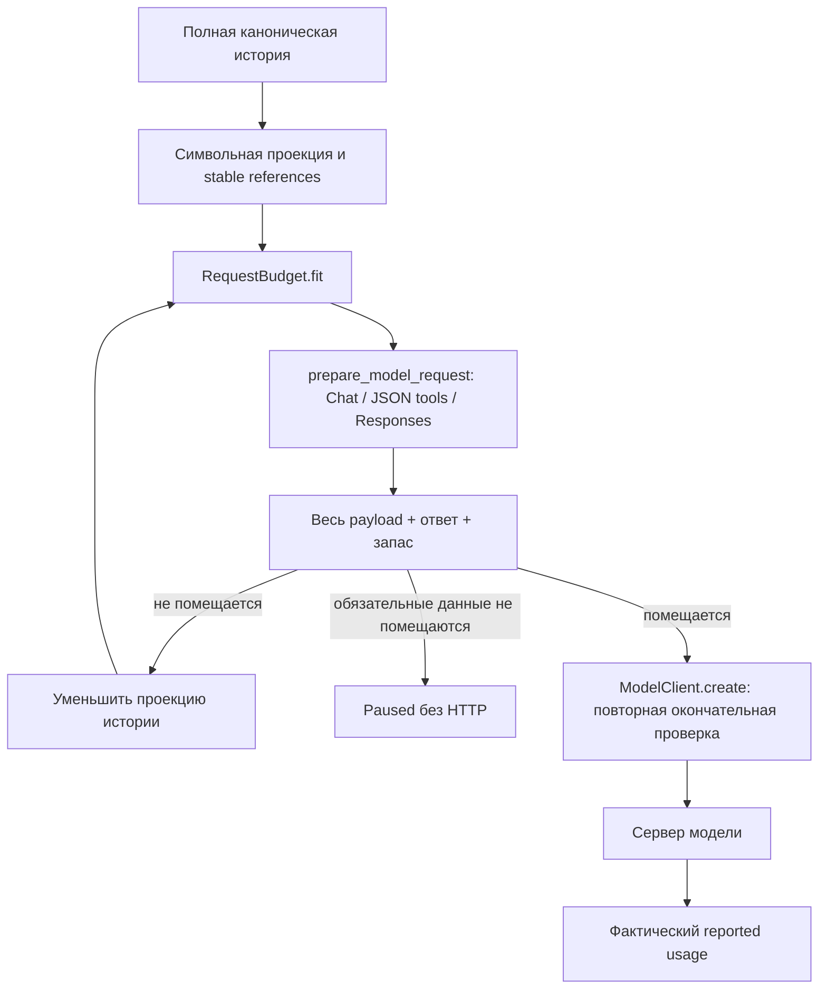

# Этап 3: полный бюджет контекста и экономия

Историческое описание ручной системы. Текущая автоматика и исправление оценки
UTF-8 байтов описаны в [главе 55](55-automatic-context-and-lola-layout.md).

26 октября 2026 года. Продолжение [плана ядра](40-core-audit-and-roadmap.md)
после [надёжного исполнения](42-core-execution-and-recovery.md).
Изменения относятся к рабочим исходникам Core и локальной сборке renderer/main/preload.
Установщик предыдущего этапа не пересобирался.

## Что настроить

Откройте «Настройки → Контекст и лимиты».

- **Окно загруженной модели** — фактическое окно, выбранное при загрузке модели
  в LM Studio/на сервере. Максимум, заявленный в названии модели, может отличаться.
  По умолчанию Neutral использует 32 768; это настройка, а не результат определения
  возможностей внешнего сервера.
- **Максимум токенов ответа** — сколько оставить генерации. У reasoning-модели
  этот бюджет может включать рассуждения.
- **Дополнительный запас** — сверх ответа; по умолчанию 512 токенов.
- **Бюджет символов** — прежний дополнительный предел проекции истории.
  Он сохраняется, но больше не подменяет проверку полного запроса.
- **Память проекта** — после подтверждённых записей/просьбы запомнить, выключена
  либо после каждого успешного задания. Первый вариант установлен по умолчанию.

Кнопки 4K/8K/32K одновременно выбирают окно и уменьшают максимум ответа, если
требуется, до четверти окна. Это явное действие пользователя. При выборе
«Использовать в настройках» для собственного GGUF переносятся его настоящий
`ctx_size`, адрес и ID; ответ/запас уменьшаются под это окно. Сервер GGUF при этом
не перезапускается. Само поле лимита Neutral не меняет загрузку в LM Studio.

В ходе задачи раскройте «Контекст и расход». Видны оценка входа, окно,
резерв ответа, запас, свободный остаток, состав входа, причина сжатия и число
подключённых схем MCP. Суммарные токены сервера показаны отдельно с числом
запросов, для которых сервер прислал usage. При отсутствии данных написано,
что фактический расход пока не сообщён. Эта карточка доступна и в окне Лолы.

## Почему счётчик консервативный

У произвольного локального сервера нет общего доступного офлайн-токенизатора.
`RequestBudget` измеряет UTF-8 JSON окончательного запроса и добавляет framing:
256 единиц на запрос, 32 на сообщение/input item, 64 на нативную schema.
Каждый байт учитывается как единица консервативной оценки, затем отдельно
оставляются максимум ответа и дополнительный запас.

Это намеренно завышенная оценка для обычных текстовых BPE-моделей, особенно
для русского текста; её нельзя выдавать за точный tokenizer count или будущий
счёт облачного API. Маленькое окно может отклонить запрос, который конкретный
токенизатор сумел бы принять. Настраиваемый резерв также не позволяет доказать
размер скрытого chat template произвольного сервера. Окно и запас должны
соответствовать реально используемой модели. Автоматической загрузки tokenizer
или дополнительного сетевого запроса для подсчёта нет.

Гарантия приложения: измеренный окончательный payload проходит настроенный
консервативный предел **до отправки HTTP**, либо запрос останавливается с
числами и объяснением. Сервер остаётся последним источником истины для своих
лимитов и фактического usage.

## Модули и путь запроса

| Файл | Объявления | Назначение |
| --- | --- | --- |
| [request_budget.py](../agent/request_budget.py) | `RequestBudget`, `BudgetExceededError`, `prepare_model_request`, `json_bytes` | Измерение окончательного JSON, резерв, попытки сжатия и gate до HTTP |
| [context_tools.py](../agent/context_tools.py) | `RESULT_READER_TOOL`, `MCP_DISCOVERY_TOOL`, `read_saved_result`, `find_mcp_tools` | Дочитывание диапазонов и локальное подключение разрешённых MCP schemas |
| [context_manager.py](../agent/context_manager.py) | `ContextManager.build` | Символьная проекция, причины сжатия и устойчивые канонические якоря результатов |
| [smart_context.py](../agent/smart_context.py) | `smart_compact_messages`, `compact_tool_result`, `context_archive` | Сохранение ограничений/evidence и whole tool-пар при уменьшении истории |
| [model_client.py](../agent/model_client.py) | `ModelClient.create`, `ModelStream._produce`, `record_usage` | Повторный финальный gate, реальный HTTP и usage Chat/Responses |
| [engine.py](../agent/engine.py) | `_model_create`, `_dispatch_tool`, `_sync_usage`, `_should_update_memory` | Общая политика запросов агента, вспомогательных проверок и памяти |
| [ContextUsage.tsx](../apps/desktop/src/ContextUsage.tsx) | `ContextUsage`, `RequestBudgetSnapshot`, `ModelUsageSnapshot` | Отдельные представления оценки контекста и наблюдаемого расхода |
| [GenerationFields.tsx](../apps/desktop/src/GenerationFields.tsx) | `GenerationSettings`, `GenerationFields` | Общие настройки окна/резерва/памяти с пресетами и проверками |



`prepare_model_request` один для измерения и транспорта. Он учитывает:

- Native Chat: сообщения, инструменты, параметры и telemetry field.
- JSON tools: schemas и протокол внутри system, JSON escaping результатов,
  превращение tool-сообщений в user-данные.
- Responses: instructions, input/function_call_output, tools, encrypted reasoning
  из cache, `max_output_tokens` и остальные поля после преобразования.

Схемы, перенесённые в JSON system prompt, учитываются ровно один раз;
для UI их вклад выделяется из инструкций. Metadata, которую адаптер действительно
не отправляет, не считается входом модели. Внутренний `_source_message_index`
удаляется до адаптации и никогда не попадает в HTTP.

## Сжатие и управляемая остановка

`fit` работает с независимыми копиями, не более восьми измерений.
При превышении уменьшает символьный предел проекции и снова измеряет уже
адаптированный запрос. Защищаются первоначальный текущий запрос, последний
внутренний запрос продолжения, system instructions, последняя tool-пара и
неизменённые аргументы вызовов, включая полный код `write_file`.
Ограничения из старых пользовательских сообщений сохраняются прежним архивом.
Если они или другие обязательные данные не помещаются, текст не обрезается.

`BudgetExceededError` переводит задачу в paused. В карточке появляются blocked
и объяснение: вход, ответ, запас, окно; можно изменить настройки и продолжить.
Ошибка не содержит исходный код или содержимое секретов.
Избыточный размер schemas нельзя скрыть сокращением только сообщений.
Вспомогательные completion-check и обновление памяти проходят тот же gate,
но их бюджет хранится отдельно в `aux_budget`, не заменяя основной breakdown.

Прежние профили получают новые значения по умолчанию без переноса API-ключей.
Legacy-профиль с прежним максимумом ответа 32 768 не сбрасывает URL/ID модели:
противоречие нового окна исправляется пользователем, запрос до этого не отправляется.
Новые явно заданные противоречивые окно/ответ/запас отклоняются при сохранении.

## MCP без постоянной передачи всех схем

`TaskService` по-прежнему получает permission snapshot всех включённых групп,
серверов и инструментов. Полные MCP definitions выделяются в `deferred_tools`.
В начальном запросе отправляются встроенные активные tools и
`discover_mcp_tools`; полных внешних schemas там нет.

`discover_mcp_tools(query, limit)` ищет локально по имени сервера, исходному
имени действия и описанию. Доступны русские/английские ключевые слова, пустой
query показывает начало каталога. По умолчанию подключаются до четырёх схем,
максимум — восемь. Результат содержит aliases и короткие описания; schemas
появляются в tools следующего модельного запроса без дублирования в результате.
Следующий поиск заменяет этот набор, оставляя встроенные инструменты.

Сам поиск не создаёт MCP-процесс и ничего не исполняет. Выключенные пользователем
серверы/tools отсутствуют в snapshot, а неизвестный или ещё не подключённый alias
отклоняется `ToolPolicy`. Внешнее исполнение сохраняет подтверждения и журнал
этапа 2. Профиль только с MCP, без остальных групп, также получает discovery.

Поиск требует дополнительного модельного хода перед первым внешним вызовом.
Это уменьшает постоянную стоимость больших каталогов; для одного маленького
инструмента не обещается снижение суммарного расхода каждого задания.
Долгоживущие MCP sessions остаются следующему сервисному этапу.

## Диапазоны полного результата

Сжатые результаты и архив содержат `source_tool_call_id` и
`source_message_index`. Индекс адресует tool-сообщение в полной истории
текущего чата **без system prefix**, а не позицию в сжатом HTTP-контексте.
Внутренний marker переносит этот индекс через несколько независимых проекций.

`read_tool_result` принимает этот индекс, `call_id`, `offset` (по умолчанию 0)
и `limit` (по умолчанию 4096, от 64 до 6000 символов). Возвращает диапазон,
длину полного результата, SHA256 и `next_offset`, либо ошибку несоответствия
якоря. Диапазоны измеряются Python Unicode-символами, не UTF-8 байтами.

Reader читает только уже имеющуюся историю выбранного чата. Он не открывает
файл, не запускает команду и не повторяет MCP. Данные помечены untrusted.
`ok=true` здесь означает успешное **чтение**, а не успех исходной команды:
её результат находится в сохранённом JSON. Повторяющиеся IDs в разных пачках
не смешиваются благодаря индексу сообщения.

Хранилище полных результатов остаётся прежним: канонический чат и журнал.
Это не новый ArtifactStore и не перенос данных в SQLite.

## Фактический расход и память

Для Chat streaming запрашивается `stream_options.include_usage`.
Если сервер явно отвергает именно это необязательное поле с 400/422 до потока,
повторяется запрос без него. Другие параметры автоматически не убираются,
полученный частичный поток не повторяется. Без usage оценка не становится фактом.

В Chat принимаются `prompt_tokens`/`completion_tokens`, в Responses —
`input_tokens`/`output_tokens`, включая нестриминговые ответы. Из нескольких
накопительных usage одного потока учитывается последний один раз.
Некорректные, отрицательные и не целочисленные значения игнорируются.
UI сообщает также покрытие, например «по 2 из 3 запросов».
Денежная цена не вычисляется: модель/endpoint не доказывают тариф пользователя.

`memory_updates=on_change` запускает отдельный запрос памяти после успешного
`write_file` либо явной просьбы «запомни»/`remember`. Обычный вопрос и просмотр
файлов его пропускают. Изменения, сделанные произвольной программой или MCP,
сами по себе не распознаются как подтверждённая запись файла; при необходимости
используйте явную просьбу или режим always. Режим off отключает автоматическое
обновление. Готовая память проекта продолжает передаваться при работе с проектом.

## Проверки

16 новых регрессий в [test_request_budget.py](../tests/test_request_budget.py):
окна 4K/8K/32K для native/JSON, длинный русский запрос, большие schemas,
encrypted Responses, полный write-код, references после двух сжатий, диапазоны
Unicode, MCP-only профиль, lazy policy, экономия памяти, сохранность legacy
настроек, настоящий HTTP gate без отправки, reported usage и fallback telemetry.
Существующая Responses-фикстура проверяет реальный usage ещё и для этого API.

GUI smoke проверяет 4K/32K пресеты, сохранение настроек, отсутствие MCP schemas
в первом запросе, их появление после discovery и раскрытие breakdown/usage.
Снимок `.test-data/neutral-gui/context-usage.png` — локальный тестовый артефакт,
исключённый Git. Подмена временного профиля не заменяет проверку качества реальной
LLM; платный API и GPU-модели для этих регрессий не запускались.

| Итоговая проверка | Результат |
| --- | --- |
| Полный unit suite | 244 теста, OK; 1 skip — привилегия создания symlink в Windows |
| Migration/HTTP/bridge/streaming/voice | 76 тестов, OK |
| Новые бюджет/context/usage регрессии | 16 тестов, входят в unit suite; дополнительно обновлена Responses-фикстура |
| TypeScript, Vite, Electron main/preload | Сборка — OK |
| Electron | Neutral smoke и прежний editor/voice smoke — OK |
| Документация | 6 актуальных справочников, 62 Markdown-файла, 2266 локальных ссылок — OK |

Основные команды из корня:

```powershell
$env:LOCALAPPDATA = Join-Path (Get-Location) '.test-data/stage3-unit'
.\.venv-test\Scripts\python.exe -m unittest discover -s tests -q
.\.venv-test\Scripts\python.exe -m unittest discover -s tests/migration -q
npm run build
$env:LCA_PYTHON = (Resolve-Path .\.venv-test\Scripts\python.exe).Path
$env:LCA_TEST_PYTHON = $env:LCA_PYTHON
.\node_modules\.bin\electron.cmd tests/electron/neutral-smoke.cjs
.\node_modules\.bin\electron.cmd tests/electron/smoke.cjs
.\.venv-test\Scripts\python.exe tools/generate_code_reference.py
.\.venv-test\Scripts\python.exe tools/check_docs.py
```

Текущая версия установщика и установленное приложение остаются прежними.
Рабочая ветка — `codex/electron-agent-bridge`, исходный HEAD —
`9572082e8f0c4ce625e515fdb7e5c0ac466a8b09`. Изменения аудита и этапов 1–2
сохранены. Новые изменения этапа 3 остаются локально без нового commit/push/PR.
Рабочие инструменты IDE, поиск, диапазоны исходных файлов, patch и локальные
инструкции проекта описаны в [следующем выполненном этапе](44-ide-tools-and-progress-panel.md).
