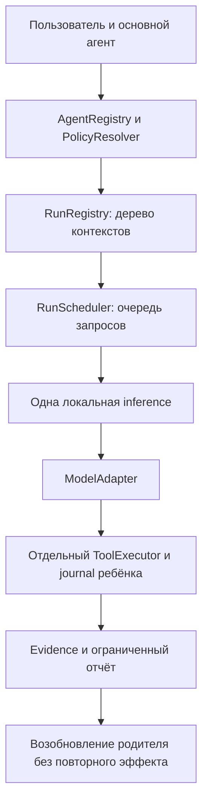

# План пользовательских и создаваемых моделью субагентов

Это проектирование следующего этапа, не включённая сейчас возможность Neutral.
Субагент — самостоятельный run с собственным контекстом и ограничениями внутри
пользовательской задачи. Он не является обязательной ролью цепочки из четырёх моделей.

## Пользовательский сценарий

Раздел «Субагенты»: создание, дублирование, импорт/экспорт, включение и удаление
профилей. Поля: имя, назначение, инструкции, модель/подключение, инструменты,
навыки/MCP, область проекта, бюджет, readonly/изолированные правки. Шаблоны:
«Исследователь», «Ревьюер», «Тестировщик», «Исполнитель». По умолчанию readonly.
Пользователь запускает профиль кнопкой у задачи либо явно упоминает его в запросе.

В ходе работы появляется дерево: родитель → дети, статус, модель, срок,
потраченные запросы/токены, ожидающее решение, итог, источники и diff. Можно открыть
транскрипт ребёнка, остановить одного или всё дерево. Закрытие панели задачу не
останавливает. Отчёт не скрывает ошибки и непроверенные выводы.

## Предлагаемые сущности

| Сущность | Данные и ответственность |
| --- | --- |
| AgentDefinition / AgentRegistry | UUID, version, name/description/instructions, source=user/model, connection_ref, tools/scopes, budgets, approval policy, enabled. Личные и проектные определения с явным приоритетом. |
| RunContext / RunRegistry | run_id, root_run_id, parent_run_id, definition_version, chat/task IDs, immutable root/scope, cancellation, state, journal. Не используют единственный self.chat TaskService. |
| RunScheduler | Очередь и fair per-request inference leases; waiting_child, queued, active, waiting_approval, completed/failed/paused. Нельзя удерживать inference lease, ожидая ребёнка. |
| BudgetLedger | Ограничения родителя и reserved доля ребёнка: deadline, requests, tokens, tool calls, children/depth. Ребёнок не продлевает срок и не создаёт новый независимый безлимитный бюджет. |
| AgentPolicyResolver | Пересечение прав parent/definition/workspace/user grants. Инструкция и описание не выдают права. MCP annotations не являются разрешением. |
| SubagentReport | Итог, status, evidence refs, files/hashes, tests, unresolved questions, usage; полный transcript хранится отдельно, summary bounded. |

Данные runs/definitions/relations хранить транзакционно в versioned SQLite migration
со связями parent/root. Большие отчёты — ArtifactStore. Каждый ребёнок получает
свой CallJournal; message_index/call_id не смешиваются с родительскими. Ключи
подключений остаются в SecretStore/памяти и передаются через handles, не в prompt,
экспорт профиля или события. Миграцию проверить на текущих Chat/voice/task backups.

## Что может создавать модель

Предлагаемый инструментарий: `agents_list`, `agent_draft`, `spawn_agent`,
`agent_status`, `await_agent`, `cancel_agent`. Имена tools должны проходить тот же
native/JSON adapter и schema validation, что остальные инструменты.

Модель может:

- создать временный readonly профиль для текущего run в заранее разрешённых пределах;
- предложить постоянный профиль как выключенный черновик, который виден пользователю;
- выбрать включённый профиль и передать ограниченную самостоятельную подзадачу.

Модель не может включить свой постоянный черновик, расширить scopes, назначить себе
секрет, добавить произвольный исполняемый MCP server или разрешить запись через
текст инструкции. Расширение прав/постоянное включение оформляется явным UI.
Если пользователь заранее разрешил определённый шаблон/бюджет, повторного вопроса
для каждого безопасного spawn не требуется. Границы этого разрешения сохраняются
в задаче и видны в карточке.

## Ресурсы и файлы

Первая версия: depth=1, максимум 3 дочерних запуска на задачу, одна тяжёлая локальная
inference. Дети — отдельные контексты той же загруженной модели по умолчанию;
дополнительная VRAM из-за второй LLM не выделяется. Другой профиль модели разрешён,
но смена загрузки выполняется ресурсным менеджером по явной настройке, без выгрузки
чужой модели из LM Studio. Облачную параллельность пользователь включает отдельно.

Readonly дети могут исследовать независимо, но HTTP requests исполняются по очереди.
Для writer-субагентов — отдельные owned worktrees и paths/leases. Изменения ребёнка
возвращаются как proposal/diff. Применение в основной проект требует проверки hash/
document version и привычного approval; автоматического merge нет. На не-Git проекте
в первой версии writer отключён, readonly продолжает работать.

Родитель передаёт цель, критерии, релевантные материалы и anchors, а не всю историю.
Результат ребёнка считается недоверенными данными, не system instruction. Обновление
общей памяти — отдельное проверяемое действие родителя с provenance. Зацикленное
делегирование ограничивается ledger, depth, повторяющимися задачами и дедлайном.

## Порядок и проверки

1. Завершить этап 9: response outcomes/revision/access. Ввести RunContext/registry
   совместимыми адаптерами; существующий одиночный цикл работает без новых children.
2. Реализовать scheduler + ledger и queue UI. Проверить ожидание с освобождённым
   lease, cancel queued/running/awaiting approval и source correlation всех событий.
3. Добавить registry/form/export, затем ручной readonly spawn и bounded reports.
4. Добавить модельный временный профиль и persistent drafts, затем writer worktrees.
5. Проверить crash/restart после spawn, до эффекта, после receipt, перед handback.
   Неизвестный effect ребёнка блокирует повтор ребёнка, а не воспроизводится заново.

Acceptance: отмена родителя останавливает дерево; старое событие ребёнка не меняет
новую задачу; права не увеличиваются; суммарный расход не выходит за root budget;
одна LLM не пересекается с другой на локальном GPU; документы/проверки после child
apply получают новую revision. Native и JSON модели выполняют одинаковые сценарии.

Ориентир — независимый контекст, специализированные права и bounded handback,
описанные в [Claude Code subagents](https://code.claude.com/docs/en/sub-agents).
Приведённая архитектура Neutral — наше решение; внутренний код Claude не исследован.
