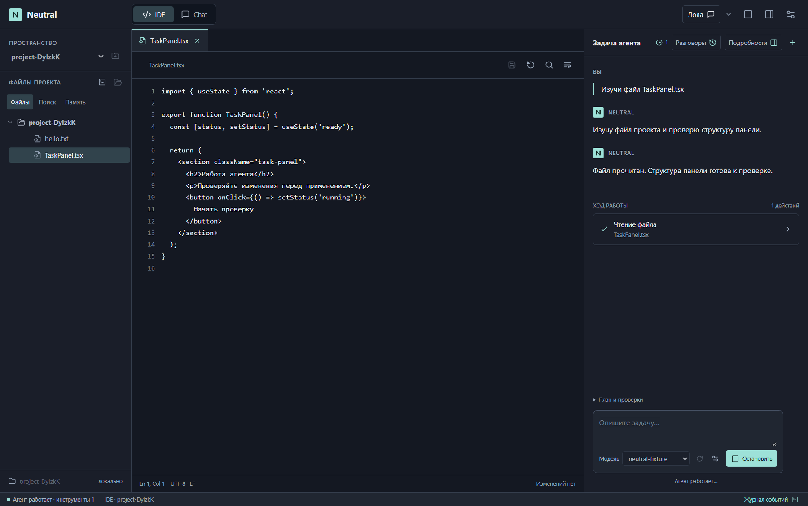
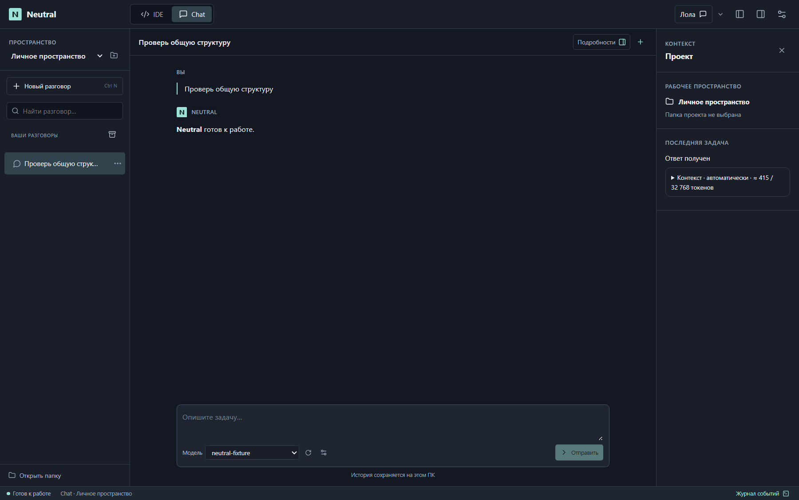

# Neutral Studio — интеграция утверждённого интерфейса

28 октября 2026. Пользователь утвердил визуальный прототип и разрешил заменить интерфейс основного приложения. Рабочая реализация находится в `apps/desktop/src`, оболочка — в `apps/desktop/electron`. Python backend в рамках этой интеграции не изменялся. Предыдущие незакоммиченные исходники перед правками сохранены локально в `.test-data/ui-before-integration-20261028`.

## Итоговая компоновка

- Сверху — IDE / Chat, открытие всплывающей Лолы, голосовая активация в её меню, скрытие панелей и настройки.
- IDE: настоящее раскрываемое дерево проекта слева, редактор с вкладками в центре, чат агента справа. История IDE открывается кнопкой «Разговоры» на месте переписки, аналогично подробностям задачи. Инструменты показаны в ленте; план, проверки, журнал запусков, восстановление и откат доступны в подробностях.
- Chat: история слева, переписка и запрос в центре, скрываемый контекст справа или слева. Файловые инструменты режима Chat не включались.
- Модель выбирается под запросом. Список получается от настроенного сервера; выбор применяется через настоящий `configureModel`. Есть явное обновление списка и переход к настройкам.
- Настройки занимают окно и сохраняют существующие формы провайдера, профилей, расширений, голоса, подключений, runtime и хранения. Добавлены поиск разделов, доступ к возможностям IDE, изменение ширины категорий и именованные раскладки.
- Общая палитра — графит и мята, знак N одинаков в UI и SVG / PNG / ICO. При первом запуске Studio применяется мятный акцент и включается строка состояния; остальные сохранённые параметры оформления учитываются. После этого выбор акцента сохраняется обычным образом.

## Сохранённые рабочие действия

| Область | Реализация |
| --- | --- |
| Проекты и история | Существующий `ConversationSidebar`: создание/выбор проекта, инструкции, поиск, pin, переименование, архив, ветка, перенос, экспорт и удаление с подтверждением |
| Файлы | `StudioFileTree` получает настоящие каталоги через IPC; `EditorPanel` сохраняет поиск, строку, вкладки, dirty state, перечитывание и запись через проверку ревизии и diff |
| Работа агента | Существующие `useTaskSession`, `TaskProgress`, `TaskGraphPanel`, `RunHistory`, `WorkspaceReview`, `IdeTaskOptions` и `SourceContextPreview`; действия в ленте берутся из настоящего журнала инструментов |
| Память и поиск | Действующие `MemoryPanel` и `ProjectSearch`, индекс, символы, границы доступа и сохранение ревизий |
| Лола | Собственная сессия во всплывающем окне, общий Core, история, текст/запись, озвучивание, параметры паузы/автоотправки, подтверждения и восстановление; передача задачи основной модели |
| Прочие сервисы | Действующие формы навыков, MCP, субагентов, desktop tools, Telegram, LSP, worktree, Docker, локальной модели и STT/TTS |

Демонстрационные сообщения, проценты и результаты из прототипа в основной интерфейс не переносились. Тексты, статусы, ошибки и счётчики берутся из рабочих сервисов. Markdown поддерживает безопасное ограниченное подмножество, код и копирование; raw HTML не исполняется.

## Лола и IPC

В главном окне больше нет третьей вкладки или встроенного экрана Лолы. `useLolaSession` владеет отдельным разговором в popup; `VoicePanel` используется как контроллер записи и озвучивания. Результаты голосового запроса не заменяют основной Chat/IDE. Запись синхронизируется с wake listener главного окна, распознанный черновик возвращается в поле popup.

Popup получает только разрешённые операции IPC: голос, собственные разговоры и запуски. Изменение основной модели и рабочего проекта запрещено; подтверждение чужого запуска запрещено. Происхождение sender и основного frame проверяется. Core и очередь вывода остаются общими.

## Проверки

| Проверка | Результат / свидетельство |
| --- | --- |
| `npm run build` | TypeScript, Vite, основной Electron preload и preload Лолы прошли |
| `npm run test:ui` | 22 запроса к локальной fixture-модели; настоящие renderer / IPC / Core, проекты, профили, MCP, команды, редактор, план, критерии, источники, recovery, снимки и откат; `.test-data/studio-smoke/result.json` |
| `npm run test:ui:visual` | Chat, активная задача IDE, открытый TSX, инструменты, история, пустой поиск, ошибка модели и настройки при 1280×720 / 1440×900 / 1920×1080; `.test-data/studio-visual/result.json` |
| `npm run test:ui:layout` | Pointer / keyboard resize, ограничение ширины, сохранение после reload, именованная раскладка, Ctrl+K / Escape, фильтр настроек, реальное переключение модели и IME; `.test-data/studio-layout/result.json` |
| `npm run test:ui:lola` | Один Core, работа при скрытом главном окне, неизменность основной переписки, разрешения IPC, ручная проверка прерванного действия без повтора, синхронизация записи, параметры, native overlay / tray / drag / animation / click-through; `.test-data/lola-gui/result.json` |
| `npm run test:ui:background` | Два разговора, held stream, переключение/возврат без дублирования и остановка ожидающей задачи |
| `npm run test:ui:optional` | Исследование, LSP, чистые/изменённые worktree, Docker availability и компактная светлая форма; `.test-data/sopt/result.json` |
| Небольшие Node-проверки | Desktop applications, microphone, assistant media и границы/настройки Лолы прошли; assistant-media повторён вне sandbox после EPERM на тестовый junction |

Модель в GUI-тестах детерминирована и работает на loopback. Действия с временным проектом и сохранением выполняются настоящими сервисами. Это не проверка качества произвольной внешней модели. Полный аппаратный путь микрофона / STT / TTS, пользовательский Telegram/MCP и доступность внешних LSP/Docker требуют настроенного окружения. Windows installer в этом проходе не собирался и не устанавливался.

## Визуальная проверка

На каждом размере просмотрены основные области и изменённые состояния. Исправлены горизонтальный скролл в истории, лишние интервалы сообщений, обрезание заголовка агента, высота вкладок, контраст управляющих элементов, плотность заголовков настроек и поведение модальных клавиатурных команд. Физическое разрешение PNG учитывает DPI Windows; размеры в названиях обозначают запрошенный размер содержимого в CSS px.

Основные изображения сохранены в репозитории:

[История IDE](screenshots/studio/ide-history-1280x720.png) · [Настройки](screenshots/studio/settings-1440x900.png) · [Ошибка](screenshots/studio/ide-error-1280x720.png) · [Лола](screenshots/studio/lola-popup.png)

## Запуск

Из корня LocalAgent: `npm run build`, затем `npm start`. Собранный интерфейс открывается без Vite-сервера. `npm run dev` и `run-desktop.bat` продолжают запускать режим разработки с явным флагом `--development`. Для исходного Python Core нужен настроенный интерпретатор; путь можно задать в `LCA_PYTHON`. История и настройки не заменяются тестовыми профилями.

Статический прототип в `prototypes/neutral-studio` остаётся справочным артефактом утверждённого дизайна.

## Установщик и прежний знак Neutral

28 октября 2026: знак N с точкой адаптирован под Studio; локально собран и проверен установщик 7.0.1. [Состав, проверки и SHA-256](70-studio-installer-7.0.1.md).
